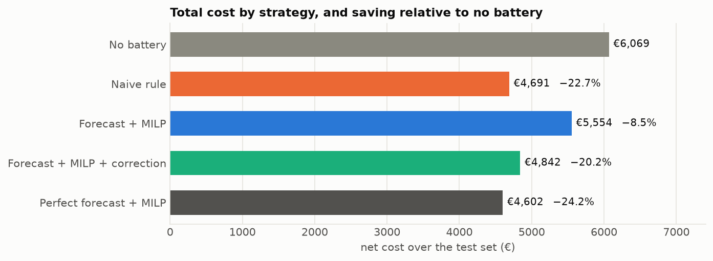
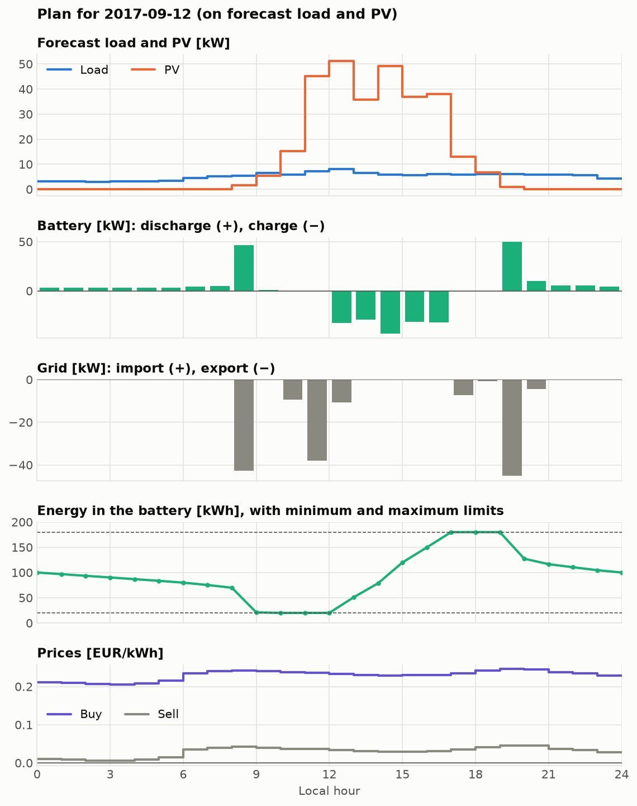
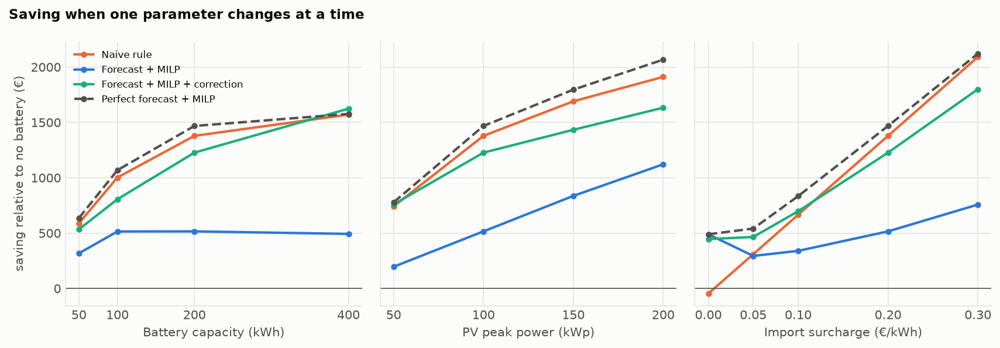
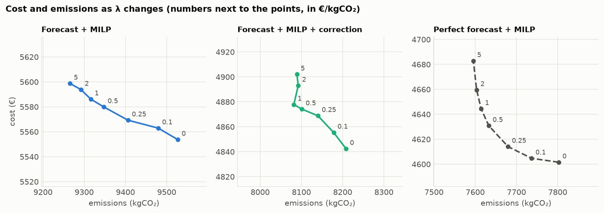

# Microgrid EMS

[](https://github.com/irreprensibile22/MicroGrid/actions/workflows/ci.yml)

Energy management of a microgrid with a *predict-then-optimise* approach: a machine-learning model forecasts next-day load and PV output, and a MILP model decides hour by hour how to use the battery and the grid to minimise cost and emissions.

## Main result

**Question: how much do we save, in cost and CO₂, by running the battery with forecasting + optimisation rather than with a simple rule?**

**Answer: with the reference tariff, nothing.** Over 125 days of real data, the battery run with forecasting + optimisation cuts cost by 20% and emissions by 22% compared with having no battery. But a rule that charges when there is spare sun and discharges when there is not does better: −23% cost, −25% emissions.



- **−20.2% cost** with forecast + MILP + real-time correction; **−22.7%** with the naive rule; **−24.2%** knowing the future.
- **Executing the plan to the letter is expensive**: only −8.5%. Letting the battery absorb the forecast error instead of the grid is worth €711, three quarters of what a perfect forecast would give.
- **The tariff decides.** With an import surcharge up to 0.10 €/kWh, optimisation is ahead or level; with no surcharge it is the only strategy that makes money. From 0.20 €/kWh up, the naive rule wins.

The full analysis is in [notebooks/03_results.ipynb](notebooks/03_results.ipynb).

## Pipeline


| Step | Module | Command |
|---|---|---|
| Download | [data.py](src/microgrid/data.py) | `python -m microgrid.data` |
| Cleaning | [dataset.py](src/microgrid/dataset.py) | `python -m microgrid.dataset` |
| Forecast | [features.py](src/microgrid/features.py), [forecast.py](src/microgrid/forecast.py) | `python -m microgrid.forecast` |
| Optimisation | [optimize.py](src/microgrid/optimize.py) | `python -m microgrid.optimize` |
| Simulation | [simulate.py](src/microgrid/simulate.py) | `python -m microgrid.simulate` |
| Comparison | [evaluate.py](src/microgrid/evaluate.py) | `python -m microgrid.evaluate` |

## How to run

Python 3.12 is required. From the repository folder:

```
python -m venv .venv
source .venv/bin/activate
pip install -r requirements-lock.txt && pip install -e . --no-deps
python scripts/run_all.py
```

`run_all.py` runs the whole pipeline in about 10 minutes: it downloads the data, cleans it, trains the models, simulates, compares the strategies and re-runs the notebooks. The data is not in the repository: it is downloaded from the sources.

- **Tests.** `pytest` runs 90 tests and needs no data.
- **Parameters.** They are all in [config/default.yaml](config/default.yaml).
- **Reproducibility.** The random seed is fixed and LightGBM runs in deterministic mode. `requirements-lock.txt` holds the exact versions used for the results; for the latest ones: `pip install -e ".[dev]"`.
- **Automated checks.** On every push GitHub Actions runs `ruff` (lint and formatting) and the tests.

## Problem

Two households in Konstanz (Germany), run as a single grid-connected microgrid with a PV plant and a shared battery. Every day the operator decides the charge and discharge plan for the following day. Load and PV output cannot be controlled: they can only be forecast.

| Parameter | Symbol | Value |
|---|---|---|
| PV peak power | — | 100 kWp |
| Battery capacity | `E_max` | 200 kWh |
| Maximum charge/discharge power | `P_max` | 50 kW |
| Charge and discharge efficiencies | `η_c`, `η_d` | 0.95 |
| Minimum and maximum state of charge | `SOC_min`, `SOC_max` | 10% and 90% (20 and 180 kWh) |
| Maximum power exchanged with the grid | `G_max` | 100 kW |
| Surcharge on imported energy | `τ` | 0.20 €/kWh (assumed) |
| Emission weight | `λ` | 0 €/kgCO₂ by default |

- **Resolution and horizon.** 1-hour step; the 24 hours of day D+1 are planned.
- **Tariff.** We buy at the day-ahead price plus `τ` and sell at the day-ahead price.
- **Objective.** Minimise the net cost of the energy exchanged with the grid plus the emissions of the imported energy, weighted by `λ`.

## Data

Five hourly series over **1 November 2015 – 3 February 2018** (826 days, 19,824 hours), all for Konstanz or Germany.

| Series | Source | Content | Licence |
|---|---|---|---|
| Load | [Open Power System Data, *Household Data*](https://data.open-power-system-data.org/household_data/2020-04-15/) (version 2020-04-15, CoSSMic project) | Meter readings of households in Konstanz | CC BY 4.0 |
| PV | [PVGIS 5.3](https://re.jrc.ec.europa.eu/pvg_tools/en/) (European Commission, JRC), SARAH-3 radiation | Simulated output for 1 kWp in Konstanz, south-facing modules tilted 35°, 14% losses | Free reuse with attribution |
| Weather | [Open-Meteo](https://open-meteo.com/), historical archive | Temperature, irradiance, cloud cover in Konstanz | CC BY 4.0 |
| Price | [Energy-Charts](https://energy-charts.info/) (Fraunhofer ISE), Bundesnetzagentur / SMARD.de data | Day-ahead price of the DE-AT-LU zone | CC BY 4.0 |
| Carbon intensity | [Energy-Charts](https://energy-charts.info/) (Fraunhofer ISE), German generation by source every 15 minutes | Computed from the generation mix | CC BY 4.0 |

The dataset is explored in [notebooks/01_exploration.ipynb](notebooks/01_exploration.ipynb).

### Cleaning

- **Single index.** All series are on an hourly UTC index, referring to the start of the hour. Days are those of local time in Konstanz: the days of the clock change have 23 or 25 hours.
- **Invalid days.** In the load dataset many meter readings were interpolated by the provider. An interpolation spreads the energy of the hours involved evenly: the total is right, the hourly shape is not. Gaps up to 6 hours are accepted; days containing longer gaps are flagged as invalid (50 out of 826, all in the training data).
- **Anomalous values.** Negative consumption is treated as missing. PV output with zero irradiance is set to zero.
- **Split.** Chronological and by whole days: training up to 31 May 2017 (70%), validation from 1 June to 1 October 2017 (15%), test from 2 October 2017 to 3 February 2018 (15%).

### Choices about the data

- **Households.** The load is the sum of two households (`residential4` and `residential5`), the only ones with complete and lightly interpolated measurements for more than two years. With more households the profile would be smoother, but the usable period would shrink to 15 months and the days to exclude would rise above 20%.
- **Consumption behind the meter.** For `residential4`, which has PV behind the meter, consumption is rebuilt as import + production − export.
- **Load rescaling.** The real aggregate load has a mean of 1.1 kW and a peak of 6.3 kW. It is multiplied by 7.95 to bring the peak to 50 kW, in line with a 100 kWp plant. The shape of the profile is real, the scale is not: it is equivalent to studying the two households with a plant eight times smaller.
- **Simulated PV.** Output is not measured but simulated by PVGIS from the satellite radiation of the same hours. The value of each hour is that of the instant seen by the satellite, about 10 minutes after the start of the hour.
- **Bidding zone.** During the period Germany was in the DE-AT-LU zone, split into DE-LU and AT on 1 October 2018.
- **Carbon intensity.** It is the mean of the life-cycle emission factors (IPCC AR5, Annex III) weighted by the national generation of each source. The factors are in `config/default.yaml`.

## Method

### Forecast

At midnight between day D and day D+1, load and PV are forecast for each hour of D+1, with one LightGBM model per quantity.

- **Features.** Calendar (hour, day of week, Baden-Württemberg holidays, season, with sine/cosine encoding), weather of day D+1, values 24, 48 and 168 hours earlier, mean of the previous day and of the previous 7 days.
- **No future information.** Features only use measurements up to the end of day D; invalid days are not used. A test checks that changing the data of day D+1 does not change its features.
- **Hyperparameters.** Chosen with a 4-fold expanding-window cross-validation on the training data only.
- **Refitting.** During validation and test the model is refitted every 7 days on all measurements available up to then.
- **Baseline.** Naive forecast: same hour 7 days earlier for load, same hour of the previous day for PV.

Results on the test set (3,001 hours), in kW:

| Quantity | Forecast | MAE | RMSE | Normalised MAE |
|---|---|---|---|---|
| Load | naive | 3.34 | 5.63 | 0.275 |
| Load | LightGBM static | 3.84 | 5.72 | 0.316 |
| Load | LightGBM refit every 7 days | 3.46 | 5.05 | 0.285 |
| PV | naive | 5.79 | 14.09 | 0.804 |
| PV | LightGBM static | 3.57 | 8.25 | 0.496 |
| PV | LightGBM refit every 7 days | 3.53 | 8.16 | 0.490 |

On PV the model cuts MAE by 39%. On load, in the test set, it **does not beat the naive forecast** on mean error (+4%), although it makes fewer large errors (RMSE −10%); in validation it beat it by 25%. The cause is a change of habits in one of the two households in winter 2017–18, which makes the load very regular from one week to the next. The analysis is in [notebooks/02_forecasting.ipynb](notebooks/02_forecasting.ipynb).

### Optimisation

For each day a MILP model chooses, hour by hour, battery charge and discharge, grid import and export, and PV curtailment. The full formulation is in [docs/formulation.md](docs/formulation.md).

```
min  Σ_t [ c_t · g_imp_t − s_t · g_exp_t + λ · e_t · g_imp_t ] · Δt
```

- **Constraints.** Power balance, state-of-charge dynamics and limits, battery and grid power limits, PV curtailment no larger than production.
- **End of day.** The battery must close every day at least at the level it started with.
- **Binary variables.** They prevent simultaneous charging and discharging, and simultaneous buying and selling. With `τ` = 0.20 €/kWh the buy price is always positive and they do not change the optimal value; they matter when we are paid to import.
- **Implementation.** Pyomo with the HiGHS solver. The tests check the power balance, the state-of-charge limits, the absence of simultaneous operations, equivalence with the no-battery case when capacity is zero, and one day whose solution was worked out by hand.

Plan for 12 September 2017, computed on forecast load and PV:



The battery covers the night load, empties itself by selling in the morning hour with the highest price, recharges on the solar surplus and sells again at the evening peak, closing at its starting level.

### Simulation

For each day of the test set the MILP plans on the forecasts, then the plan is executed on the actual data; the energy left in the battery is the initial state of the next day. A plan can be executed in two ways.

- **To the letter.** The battery follows its schedule; the grid absorbs the difference between forecast and reality.
- **With real-time correction.** We track the grid exchange the plan expected and let the battery absorb the error, with two caps: it charges at most the actual surplus and discharges at most the actual deficit, on top of the grid trades the plan had decided on purpose. The rule was chosen on the validation period, between two alternatives.

In both cases the battery stays within its state-of-charge limits, and PV is curtailed if the sell price is negative or the export would exceed `G_max`.

### Strategies compared

| Strategy | Description |
|---|---|
| No battery | PV covers the load, the rest goes to or comes from the grid |
| Naive rule | Charge when there is a solar surplus, discharge when there is a deficit |
| Forecast + MILP | Plan computed on the forecasts and executed to the letter |
| Forecast + MILP + correction | Same plan, executed with the real-time correction |
| Perfect forecast + MILP | Plan computed on the actual data: theoretical reference |

## Results

Test set, 125 days (2 October 2017 – 3 February 2018):

| Strategy | Cost | Emissions | Cost saving | Emission saving | Share of the theoretical saving |
|---|---|---|---|---|---|
| No battery | €6,069 | 10,496 kgCO₂ | — | — | — |
| Naive rule | €4,691 | 7,878 kgCO₂ | 22.7% | 24.9% | 94% |
| Forecast + MILP | €5,554 | 9,527 kgCO₂ | 8.5% | 9.2% | 35% |
| Forecast + MILP + correction | €4,842 | 8,208 kgCO₂ | 20.2% | 21.8% | 84% |
| Perfect forecast + MILP | €4,602 | 7,802 kgCO₂ | 24.2% | 25.7% | 100% |

- **Why the naive rule wins.** With a 0.20 €/kWh surcharge, a self-consumed kWh is worth about seven times the typical price difference between the hours of a day. Self-consumption is almost all that matters, and to maximise it you only need to react to the actual surplus: there is no need to forecast it. The gap between the naive rule and the perfect forecast is under 2% of the cost.
- **Cost of the forecast error.** Executing the plan to the letter, the actual cost exceeds the planned one by 31% (€5,554 against €4,251). The extra cost depends on the PV error (correlation +0.71 with the day's MAE), not on the load error (−0.08).
- **Value of the load forecast.** Replacing the model with the naive load forecast costs €26 more: for this problem the two are equivalent.

### Sensitivity



- **Import surcharge.** This is the parameter that decides who wins. With no surcharge the MILP takes the cost from €496 down to €7, while the naive rule loses €47 compared with having no battery; the MILP's emissions, however, double, because it buys and resells grid energy. At 0.05 €/kWh the plan with correction saves €465 against €310; at 0.10 €/kWh they are level; from 0.20 €/kWh the naive rule wins.
- **Battery capacity.** Diminishing returns: from 100 to 200 kWh the naive rule gains €377, from 200 to 400 kWh €192. The plan executed to the letter stays at about €500 whatever the capacity.
- **PV peak power.** The more sun there is, the more the battery is worth, for every strategy.

### Cost–emissions Pareto front



With a perfect forecast, weighting emissions up to 5 €/kgCO₂ cuts them by 2.6% and raises cost by 1.8%. Most of it comes early: at 1 €/kgCO₂ we avoid 188 kg for €43 more, about €230 per tonne. Emissions depend on how much energy is bought more than on when.

## Limits and simplifications

- **A single, winter test set.** The comparison covers 125 days of autumn and winter, the season with the most load and the least PV. It does not represent a whole year.
- **Observed weather instead of forecasts.** The weather of day D+1 is the observed one: no archived forecasts exist for the study period. The PV error, and so the cost of the forecast error, is optimistic.
- **Simplified tariff.** Fixed surcharge on imports, sale at the day-ahead price, no peak-power charge and no feed-in incentive. The value of `τ` is an assumption, and the results depend on it heavily.
- **Carbon intensity known in advance.** The MILP uses the actual value of day D+1. It also ignores cross-border flows and uses the same factor for lignite and hard coal: emissions are underestimated.
- **The perfect forecast is not an absolute upper bound.** The MILP plans one day at a time and must close every day at its starting level. With a 400 kWh battery, the naive rule and the plan with correction match or beat it.
- **Leftover energy.** The naive rule and the plan with correction end the period with the battery at its minimum, the other strategies half full: the difference is worth about €18 and does not change the ranking.
- **Load scale.** The profile is real, the scale is not (factor 7.95).
- **Hours without satellite data.** In 69 hours out of 19,824 the simulated output is zero while Open-Meteo reports irradiance above 50 W/m²; in 57 of them PVGIS reports zero irradiance, for instance for the whole of 16 October 2016. These are very likely hours with no satellite data. They are not corrected; only 2 fall in the test set.
- **Choices made knowing the test set.** Weekly refitting of the models was introduced after seeing how the static model did on the test set. It uses no future data and the hyperparameters did not change.
- **Midnight issue time.** A real day-ahead market needs the forecast by noon on day D, with half a day fewer measurements.
- **Ideal battery.** Constant efficiencies, no self-discharge, no degradation cost.

## Possible developments

- **Intraday re-optimisation.** Re-plan every hour with the latest measurements (model predictive control) instead of correcting with a rule.
- **Probabilistic forecasting and stochastic optimisation.** Plan over several PV scenarios, PV being the quantity whose error costs money.
- **Real weather forecasts** instead of observed weather, and a full-year test set.
- **Longer horizon.** Plan over 48 hours, or put a value on leftover energy, to drop the end-of-day constraint.
- **Other tariffs.** Dynamic retail prices, peak-power charges: the cases where optimisation has the most to gain.
- **Degradation cost** of the battery in the objective.
- **Shiftable loads**, such as electric-vehicle charging.
- **Interactive dashboard** to choose the battery size and the weight `λ`.

## Layout

```
config/default.yaml     parameters
docs/formulation.md     mathematical formulation of the MILP
notebooks/              exploration, forecasting, results
results/                tables and charts produced by the pipeline
scripts/run_all.py      runs everything
src/microgrid/          code
tests/                  tests
```

The work plan that was followed is in [microgrid-roadmap.md](microgrid-roadmap.md). Licence: [MIT](LICENSE).
